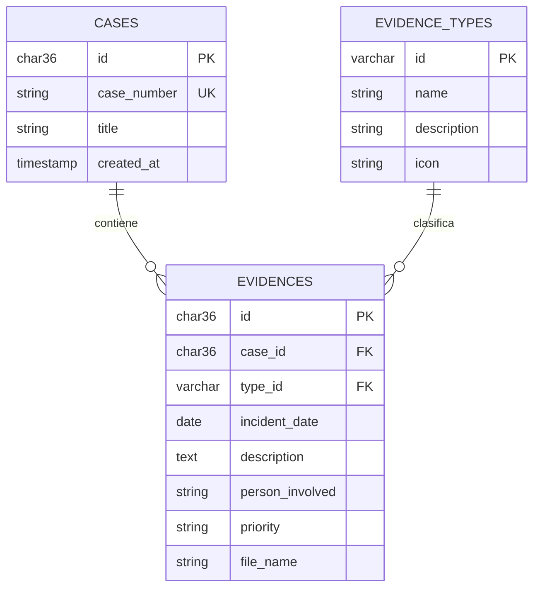

# Parte 1 — Problema, arquitectura, datos y API

## 1. Resumen ejecutivo

**Reporta Ya!** es una aplicación web responsive que centraliza incidentes y evidencias, los ordena cronológicamente y presenta un resumen comprensible. El objetivo de demo es registrar un hecho y reconstruir la historia en menos de 60 segundos. No reemplaza a las autoridades ni brinda asesoría legal.

## 2. Propuesta de nombre

Se evaluaron Evidencia+, ThreatTrack, SafeTimeline, GuardianLog, CasoSeguro, EvidenTrack, AlertaDoc, ThreatBook, SecureProof y TimelineSafe. Se elige **Reporta Ya!** por ser corto, claro en español y orientar al usuario a documentar lo ocurrido. No implica que el sistema presente una denuncia oficial.

## 3. Arquitectura

```text
Chrome (móvil/escritorio) → React + Vite + TypeScript + Tailwind
                           → Axios / HTTPS → Node.js + Express
                                             → MySQL
Frontend: Vercel | API y MySQL: Railway | Código: GitHub
```

El MVP tiene exactamente cuatro pantallas: inicio/crear caso, registrar evidencia, línea cronológica y resumen. No incluye app nativa.

## 4. Modelo de datos MySQL

Relaciones: `cases 1:N evidences`; `evidence_types 1:N evidences`. El DDL completo y los ocho tipos iniciales están en `reporta-ya-backend/sql/schema.sql`.



MySQL usa InnoDB, `utf8mb4`, claves foráneas e índices por caso/fecha. Prioridad se limita a `Bajo`, `Medio` o `Alto`. Adjuntos de demo deben ser ficticios; producción requiere autenticación, acceso por caso y almacenamiento privado.

## 5. API REST

Base: `https://<api-railway>/api`. Los endpoints validados por el MVP son:

| Método/ruta | Entrada | Respuesta/estados |
|---|---|---|
| `GET /evidence-types` | Ninguna | `200` catálogo de 8 tipos; `500` |
| `POST /cases` | JSON `{ "title": "Registro de hechos" }` | `201` caso con ID/número; `400`, `500` |
| `POST /cases/:id/evidences` | `typeId`, `incidentDate`, `description`, `personInvolved?`, `priority`; archivo opcional | `201` evidencia; `400`, `404`, `413/415` archivo, `500` |
| `GET /cases/:id` | UUID | `200` caso y evidencias; `404` |
| `GET /cases/:id/timeline` | UUID | `200` evidencias ordenadas; `404` |
| `GET /cases/:id/summary` | UUID | `200` número, conteo, timeline y recomendaciones; `404` |

Las consultas SQL se parametrizan con `?` mediante `mysql2`. CORS debe permitir solo el dominio del frontend. No devolver secretos ni contenido de archivos en logs.

## Integración de esta parte

Commits propuestos, ambos con autor **CODERT0PH**:

- `docs: add report part 1 architecture and API`
- Rama: `feature/report-parte-1` → PR hacia `develop`.
